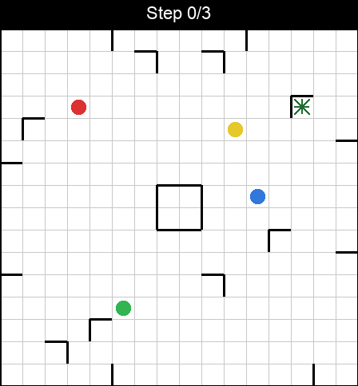
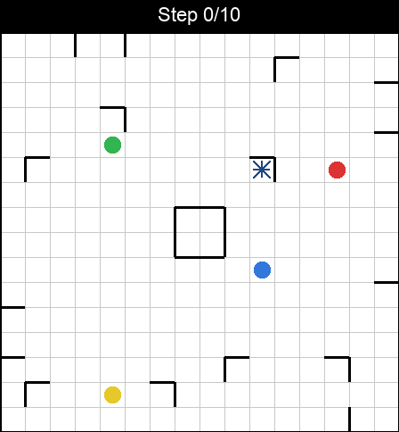

# Ricochet Robots RL Project

This repository trains reinforcement learning agents to solve Ricochet Robots while providing tooling for curriculum generation, monitoring, profiling, and mechanistic interpretability analyses.

## Demo
<!-- Currently, ResNet based models are trained to do sensible things sometimes... -->
<!--  -->
<!-- **but** not always... -->
<!--  -->

The current supported baseline is PPO with SB3's stock CNN on RGB observations.
The historical ResNet/DRC implementations remain in the repository for reference,
but training configuration rejects them until their model contracts are repaired and tested.

Sensible             |  Not sensible
:-------------------------:|:-------------------------:
  |  

<!-- Currently, ResNet based models are trained to do sensible things sometimes (left) but not always (right)
<p float="left">
  
   
</p> -->

## Quick Start

### 1. Set up a Python environment and install dependencies
```bash
python3.11 -m venv rlenv
source rlenv/bin/activate
pip install -r requirements.txt
```

### 2. Pre-compute a curriculum puzzle bank
The training defaults expect an on-disk bank housed under `artifacts/puzzle_bank`.
```bash
python src/scripts/generate_curriculum_bank.py \
  --config configs/curriculum_config_default.json \
  --bank_dir artifacts/puzzle_bank
```

### 3. Launch training from a YAML configuration (optional)
```bash
python src/scripts/train_agent.py configs/train_defaults.yaml
```
Copy `configs/train_defaults.yaml`, change the structured fields you need, and pass the new file to the same command. Unknown or unsupported fields fail validation instead of being silently ignored. Every run records a diagnostic manifest containing requested/effective environment settings, model/spaces, installed package versions, Git state, seed derivation, bank split configuration, and timestep accounting in its timestamped log directory. A fully hash-locked cross-platform environment and immutable bank content manifest remain future hardening work.

### 4. Run the Phase 2 benchmark

```bash
python src/scripts/run_phase2_benchmark.py
```

This builds a deterministic easy-puzzle fixture under `artifacts/phase2_bank`, freezes disjoint layout-hash train/validation/test suites, runs heuristic and oracle baselines, checks a tiny-set overfit milestone, and trains three stock-CNN PPO seeds. Results and checkpoints are written to `artifacts/phase2_benchmark`. See [the Phase 2 report](docs/Phase2BenchmarkReport.md) for the protocol and first MPS results.

### 5. Observe a model's gameplay
Notebook-style scripts with `#%%` cells live in `src/scripts/`; `bank_agent_rollout_cells.py` is particularly useful for loading a model.
A (badly-performing) pre-trained model exists in `examples/`.

## Repository Layout
- `src/`
  - `src/env/`: Environment core, solvers, curriculum helpers, and visuals
  - `src/models/`: Custom policy implementations (CNN, ConvLSTM/DRC, ResNet extractors)
  - `src/monitoring/`: Logging backends and collectors for metrics/rollouts
  - `src/profiling/`: Lightweight profiling utilities
  - `src/scripts/`: Executable entry points (training, evaluation, bank tooling, visualisers)
  - `src/tests/`: Pytest-based unit and integration tests
- `configs/`: YAML configurations for training profiles and baselines
- `docs/`: Research plans, progress notes, and prompt documentation
- `examples/`: Reference assets such as sample checkpoints/configs
- `artifacts/`: Output directory for generated banks, checkpoints, logs, runs, and wandb exports (created/populated at runtime)
- `WorkInProgress.md`: Rolling log of the active development task

## Key Scripts & Pipelines
- `src/scripts/train_agent.py`: Main training entry point; consumes a YAML config
- `src/scripts/evaluate_agent.py`: Evaluate PPO checkpoints on fixed layouts or random boards
- `src/scripts/run_phase2_benchmark.py`: Reproduce the fixed Phase 2 baseline and held-out evaluation
- `src/scripts/generate_curriculum_bank.py`: Build/refresh the curriculum puzzle bank (band-first controller)
- `src/scripts/precompute_bank.py`: Lower-level precomputation driver for bespoke experiments
- `src/scripts/bank_agent_rollout_cells.py`: Jupyter-style curriculum rollout visualiser
- `src/scripts/initial_testing_cells.py`: Smoke-test utilities for the environment and solver

## Configuration & Training Notes
- `configs/train_defaults.yaml` is the supported stock-CNN baseline. Older ResNet/DRC configs are retained as historical inputs and now fail clearly rather than selecting a different model.
- `bank_dir`, `log_dir`, and `save_path` defaults now point into `artifacts/` to keep generated data out of the source tree.
- Device selection defaults to `auto`; M-series Macs will pick `mps` when available.
- Supported model types are `stock_cnn` for `rgb_image`/`rgb_cell_image` and `mlp` for symbolic or legacy plane observations.
- Bank training and evaluation use stable hash-based, disjoint splits. Configure the evaluation fraction, seed, and fingerprint field in the curriculum block.

### Resume and Warmstart
Control run initialisation via YAML:
```yaml
initialization:
  mode: resume
  resume:
    checkpoint_path: artifacts/checkpoints/ppo_model.zip
    target_total_timesteps: 1_000_000
    vecnormalize_path: artifacts/runs/ppo/vecnormalize.pkl
```
For warmstarts swap `mode: warmstart` and provide `params_path`/`vecnormalize_path` instead. The legacy `load_path` is coerced to `init_mode: resume` for backwards compatibility.

## Puzzle Bank Generation & Maintenance
Top up or rebuild the bank with:
```bash
python src/scripts/generate_curriculum_bank.py \
  --config configs/curriculum_config_default.json \
  --bank_dir artifacts/puzzle_bank \
  --target_per_level 1000 \
  --max_puzzles_global 200000 \
  --chunk_per_spec 200
```
The controller consults manifest histograms when topping up coverage. It does not yet provide transactional writes or complete deduplication, so validate and back up valuable banks before large incremental jobs. Adjust `--solver`, `--max_depth`, and `--max_nodes` to trade off coverage vs computation.

## Testing
Use pytest from the project root (ensure `pytest` is installed in your environment):
```bash
python -m pytest
```

## Visualisation & Rendering
Offline renderers live under `src/env/visuals/`:
- `mpl_renderer.py`: Matplotlib-based raster renderer for quick previews
- `plotly_renderer.py`: Plotly renderer with Kaleido export for high-quality frames

For curated rollouts, open `src/scripts/initial_visualisation_cells.py`. It loads curriculum configs, banks from `artifacts/puzzle_bank`, and checkpoints from `artifacts/checkpoints/` to record or display trajectories with the renderers above.

## Current Status Overview
1. **Environment & Generator (stabilized baseline)** – Gymnasium reset streams and layout-dependent RGB caches have regression coverage; broader generator-rule validation remains ongoing.
2. **Solver & Bank Precomputation (usable prototype)** – BFS/A* and bank metadata are useful; bank durability/deduplication is future hardening work.
3. **Training Framework (Phase 1 baseline)** – Explicit stock-CNN/MLP selection, validated environment propagation, diagnostic run manifests, vector-aware callbacks, pinned direct CI dependencies, and an end-to-end smoke test on the Python 3.11 reference environment.
4. **Curriculum Training & Evaluation (Phase 2 measured baseline)** – The reproducible three-seed MPS benchmark, baselines, fixed suites, and overfit gate are implemented. The tiny overfit gate passes, but the first stock-CNN run does not clear the held-out target-robot-only baseline; see the Phase 2 report.
5. **Mechanistic Interpretability Suite (planned)** – Activation capture, linear probes, saliency/attribution, feature visualisation, activation patching; summarise findings on plan representations and causal features.
6. **Profiling & Monitoring (stabilized baseline)** – Profiling is opt-in; SB3/custom metrics share a configured logger lifecycle and backends close cleanly. Consolidation remains useful future work.
7. **Documentation & Repo Hygiene (in progress)** – Keep `WorkInProgress.md` current, ensure README/examples stay aligned with the new `src/` + `artifacts/` structure, and consolidate progress notes under `docs/`.

## Additional Resources
- `docs/ProgressNotes/`: Day-by-day engineering updates
- `docs/ComponentSpecifications/`: Detailed component-level specs
- `docs/Phase2BenchmarkReport.md`: Reproducible benchmark protocol, MPS audit, results, and next gate
- `docs/AiChatLogs/`: Conversations and decision logs
