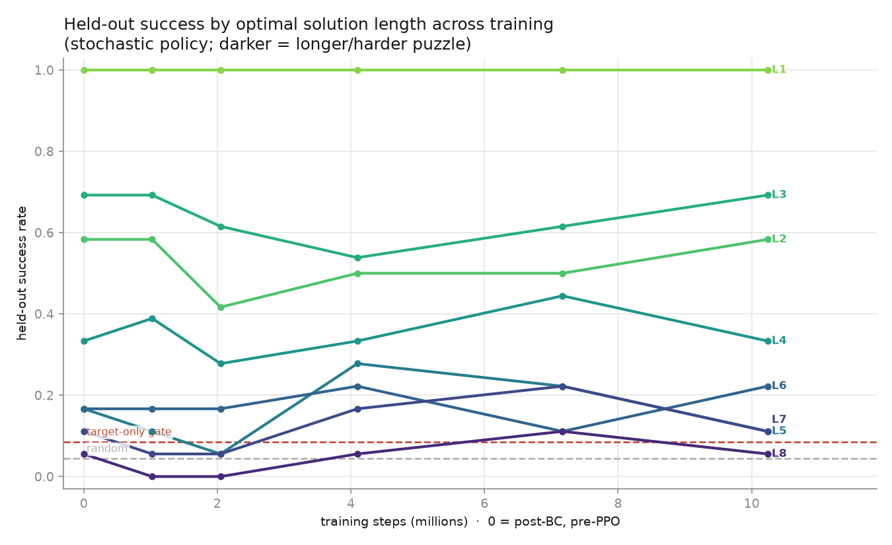
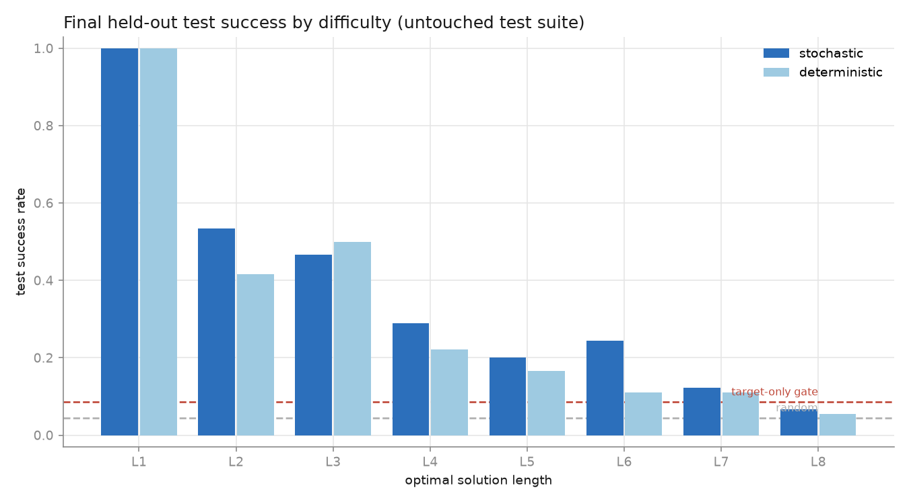
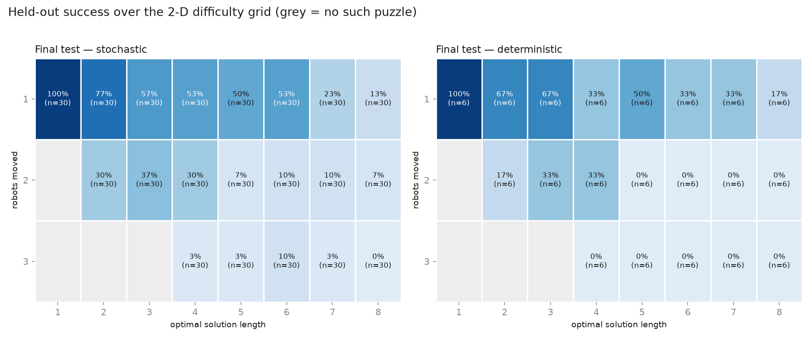

# Grid-CNN Generalization Report

Run dates: 2026-07-10 – 2026-07-12; DRC follow-up updated 2026-08-13
Branch: `sid-learnable-agent` (pushed to origin)
Baseline being fixed: `docs/Phase2BenchmarkReport.md` (stock-CNN PPO failed the held-out gate at 31.7% stochastic vs the 46.7% target-robot-only baseline, with 3.1% deterministic success and 91% no-movement actions)

**Reading order for a new contributor:** this report (the full experiment arc) → `CLAUDE.md` (hard-won operational lessons) → `WorkInProgress.md` "Phase 4b" (the live handoff and resume command). Every experiment runs through the deterministic harness in `src/benchmarking/phase2.py`; one YAML per experiment under `configs/`; outputs (gitignored) under `artifacts/phase2_experiments/<name>/` with a full `results.json` and machine-written `report.md`.

## Executive summary

The Phase 2 stock-CNN failure was an **observation-encoding × architecture mismatch**, not a task, reward, curriculum, or PPO problem. Fixing the encoding and network — with no change to the fixture, splits, baselines, reward, or PPO hyperparameters other than budget — takes held-out performance from *below the trivial heuristic* to *near-solved*:

| Benchmark | Baselines (random / target-only) | Stock CNN (old) | Grid CNN (this work) |
|---|---|---|---|
| Phase 2 easy (8×8, no interior walls, lengths 1–2, 1 robot moved) | 29.5% / 46.7% | 31.7% stoch, 3.1% det | **75.0% ± 7.8% stoch, 69.8% ± 6.5% det** (3 seeds) |
| Phase 2b hard (8×8, interior walls, lengths 1–4, ≤2 robots moved) | 14.1% / 16.6% | — | 70.7% stoch, 68.5% det (1 seed, 409k steps) |
| Phase 2c (same fixture, two-robot bands up-weighted, 819k steps) | 14.1% / 16.6% | — | **84.8% stoch, 87.0% det**; single-robot strata 97–100%, two-robot 67–68% |
| Phase 4 (16×16, 4 robots, lengths 1–8; scale-only) | 4.4% / 8.5% | — | 3.3% stoch — **failed** (from-scratch PPO, exploration wall) |
| Phase 4b (same 16×16; BC warmstart + PPO) | 4.4% / 8.5% | — | **28.8% stoch / 24.2% det final test — gate passed at 3.4×**; lengths 7–8 solved for the first time |
| DRC helper-free follow-up (12×12, 3 robots, lengths 1–8) | 14.25% / 25.96% | P1 feed-forward: 68.33% stoch / 69.17% det | **81.25% stoch / 80.42% det** at 200M; fixed DRC-held-out test previously used for P1, seed 11 |

All numbers are held-out test suites disjoint from their model's training by
layout hash. The legacy P1 artifact predates the suite-fingerprint field; exact
reproduction of all scripted-baseline aggregates strongly supports, but does
not hash-prove, its suite identity with the DRC test. That suite was held out
from DRC training/selection but was already known from P1. The 8×8 milestones
are final; 16×16 remains a separate frontier (Phase 4/4b below).

## Diagnosis

The failed baseline fed SB3's NatureCNN a 40×40 `rgb_cell_image` canvas whose real content is a 17×17 patch of single-pixel cells and walls centered in black padding. NatureCNN's first convolution (8×8 kernel, stride 4) aliases away single-pixel geometry, and the whole board is compressed to a 1×1×64 tensor before the linear head. The policy literally could not see the walls it needed to plan around — consistent with its 91% no-movement collapse.

The environment already provided a lossless encoding: `obs_mode="image"` structured planes (4 wall channels + goal + target mask + one channel per robot) at native board resolution.

## Fix

- **`src/models/grid_cnn.py` — `GridPlanesCnn`**: stride-1, same-padded 3×3 CNN (no pooling, no striding), flatten + linear projection. Exact robot/goal/wall positions stay recoverable through the whole network. ~1.26M policy parameters at 8×8.
- **`src/benchmarking/phase2.py`**: `Phase2Config` gains `obs_mode`, `policy` (`stock_cnn` | `grid_cnn`), `features_dim`, `conv_channels`, `n_conv_layers`, `two_robot_band_weight`, `run_overfit_milestone`; a shared `_build_model`; and fixture-derived (rather than Cartesian-product) split strata checks so harder fixtures validate.
- **`src/env/criteria_env.py`**: curriculum levels may carry explicit stratified `bands` (with weights); the auto-built equal-length bands remain the default.
- Contract tests in `src/tests/test_grid_cnn.py`.

## Architectures (`src/models/grid_cnn.py`)

Both extractors take channels-first structured planes and never pool or stride, so a robot one cell over changes the output — the property NatureCNN destroyed. Observation is `(C, H, W)` where `C = 4 wall planes + goal + target mask + num_robots` (8 channels at 8×8/2-robot, 10 channels at 16×16/4-robot).

- **`GridPlanesCnn`** (8×8 work): `n_conv_layers` stride-1 same-padded 3×3 convs (default 4 × 64 ch) → flatten → linear to `features_dim`. ~1.26M policy params at the 8×8 default.
- **`GridPlanesResNet`** (16×16 work): 3×3 stem → `n_blocks` residual blocks (two same-padded 3×3 convs + identity skip, default 6 × 128 ch) → 1×1 conv reducing to `reduce_channels` (32) → flatten → linear to `features_dim` (512). ~6.1M policy params at the 16×16 default. The 1×1 reduction keeps the flattened vector small (`32·16·16`) despite the wide conv trunk.

Both are wired as SB3 `MlpPolicy` + custom `features_extractor` with `normalize_images=False` (planes are already 0/1 floats), and are selected by `policy:`/`model.type:` `grid_cnn`|`grid_resnet` in the harness and `train_agent.py`, with policy↔obs-mode validation and construction/predict/update contract tests.

## Experiment log

### Experiment 1 — hypothesis test (`configs/phase2_exp1_grid_cnn.yaml`)

Same fixture (fingerprint `29c1aeb0…`), split (`b72eb184…`), and baselines as the Phase 2 benchmark; planes obs + GridPlanesCnn; seed 11; 204,800 steps (~2.4k steps/s on MPS).

- Tiny-set overfit gate: **100% deterministic at 25,600 steps** (stock CNN: 37.5% at 51,200).
- Held-out test: **62.5% det / 66.9% stoch**. Validation rose monotonically (9.4% → 71.9% det) — distribution learning, not memorization.

### Experiment 2 — three-seed confirmation (`configs/phase2_exp2_grid_cnn_3seed.yaml`)

Per-seed stochastic test success 66.9% / 82.5% / 75.6% (seeds 11/29/47); mean **75.0% ± 7.8%** (pooled Wilson 70.9%–78.7%); deterministic mean **69.8% ± 6.5%**. Every seed clears the gate individually. **Formal held-out milestone: passed.**

### Phase 2b — harder fixture (`configs/phase2b_grid_cnn.yaml`, bank `artifacts/phase2b_bank`)

8,922-puzzle deterministic fixture: 8×8, 2 robots, 1 edge-T + 1 central-L wall per quadrant, optimal lengths 1–4, robots-moved 1–2; split 6,736/1,096/1,090 by layout hash. Baselines collapse here (random 14.1%, target-only 16.6%, 0% on two-robot puzzles).

Seed 11, 409,600 steps: held-out **68.5% det / 70.7% stoch**. Single-robot strata 99–100% at every length; two-robot blocker puzzles 23–30%.

### Phase 2c — two-robot reweighting (`configs/phase2c_grid_cnn_2robot.yaml`)

Same fixture/split. Explicit band weights raise two-robot training exposure from ~13% to ~41%; budget 819,200 steps.

Held-out test: **87.0% det / 84.8% stoch**. Single-robot 100%/97%; two-robot **68%/67%** (up from 23%/30%). Mean successful optimality gap 0.66 moves. At the matched 409,600-step checkpoint the reweighted run led the unweighted one 76.4% vs 63.6% deterministic validation, so the distribution shift itself — not just the doubled budget — drives most of the gain.

## Interpretation

- A feed-forward CNN generalizes well across unseen 8×8 layouts once the observation preserves board geometry. Sparse-ish reward, the bank pipeline, PPO defaults, and modest budgets were never the blocker.
- Two-robot blocker puzzles are the genuinely hard skill; they respond strongly to exposure reweighting and remain the frontier (68% vs 100% single-robot).
- The measurement protocol (deterministic fixtures, layout-hash splits, baselines, gates) held up: every claim above is a like-for-like comparison on frozen suites.

## Phase 3 — 16×16, 4 robots: honest negative result and open problem

Scaling the identical recipe to the real game footprint (16×16, 4 robots, 16 actions, interior walls, lengths 1–6; `configs/phase3_16x16_grid_cnn.yaml`, bank `artifacts/phase3_bank`, 6,588 puzzles; baselines random 6.3% / target-only 12.3%) did **not** clear the gate within this session's scale:

| Run | Budget | Held-out test | Gate (12.3%) |
|---|---|---|---|
| No curriculum (`phase3_16x16_grid_cnn`) | 1.64M steps | 1.6% det / 5.1% stoch | failed — flat throughout |
| Staged curriculum (`phase3b_16x16_staged`, lengths 1–2 → 1–4 → 1–6) | 1.64M steps | 3.2% det / 7.0% stoch | failed |

The staged mechanism itself works: stage 0 reached the 70% training-success threshold and advanced at ~400k steps, and length-1 held-out success reached 53% stochastic. But training-suite gains did not transfer beyond that (lengths 3+ at 0%): with only ~600 stage-0 training layouts, the model memorizes rather than generalizes, and the run ended stuck mid-stage-1.

**Diagnosis: data/scale starvation, not a broken mechanism.** Recommended next steps, in order:

1. **10–50× fixture size** — the parallel deterministic builder makes this cheap (10k attempts ≈ 3 min at 8 workers; 100k+ attempts is practical).
2. **Wider/deeper residual grid CNN** — 6×64-channel same-padded convs is likely undersized for 16×16 pattern diversity.
3. **10M+ step budget** with per-stage held-out evaluation so memorize-vs-generalize is visible during training.
4. **Behaviour-cloning warmstart** from the bank's stored optimal plans (every fixture puzzle carries its BFS-optimal action sequence).
5. Multi-seed formal gating only after a single seed clears.

## Phase 4 — the scaling run: items 1–3 alone are not enough

Phase 4 executed the first three recommendations together (`configs/phase4_16x16_big.yaml`, bank `artifacts/phase4_bank`): a 55,143-puzzle fixture (lengths 1–8, robots-moved 1–3, BFS depth 8), a 6.1M-parameter residual `GridPlanesResNet`, a 4-stage length curriculum (1–2 → 1–4 → 1–6 → 1–8) with a 250k-episode stall safety-valve, and 10.24M steps at a measured 716 steps/s. Baselines on this distribution: random 4.4%, target-robot-only 8.5%.

Result: **held-out gate failed** — 3.3% stochastic vs 8.5% required; deterministic 0.8% with 95% no-movement. Mid-run validation showed genuine learning on short puzzles (length-1 held-out peaked at 67% during stages 0–1), but every stage advanced via the safety-valve rather than the 65% mastery threshold (windows 25% / 18% / 10%), and the final policy had regressed to ~random on the test mix.

Updated diagnosis: past the easiest stage, random success on length ≥3 puzzles is ~0–5%, so from-scratch PPO receives almost no reward signal — the binding constraint at 16×16 is **exploration/credit assignment**, which more data, capacity, and wall-clock do not fix. The productive next lever is item 4: **behaviour-cloning warmstart from the bank's stored optimal plans**, then PPO fine-tuning under the same gates. A perf note for anyone rerunning: `BankSampler._split_mask` is now vectorized (was `iterrows()`, 83ms per reset on this bank — see `src/tests/test_bank_split_perf.py`).

## Phase 4b — BC warmstart (`configs/phase4b_bc_16x16.yaml`)

Behaviour-cloning warmstart addresses the exploration bottleneck directly: teach the policy the solver's move function *supervised* before PPO, so PPO starts from a policy that already reaches goals often enough to get reward signal on hard puzzles.

**Mechanism** (`_bc_dataset` / `_bc_pretrain` in `src/benchmarking/phase2.py`):
- Each training-split puzzle carries its BFS-optimal action sequence. We replay that plan in the env and record a `(observation, action)` pair at **every state along the trajectory** — not just the first move — yielding **210,947 pairs from the 41,395 training puzzles** (extracted in ~18s, planes stored as uint8 to stay compact). A sanity check asserts every stored plan actually reaches the goal.
- Train the policy's action distribution by NLL / cross-entropy (Adam, `bc_learning_rate`, `bc_batch_size`) for `bc_pretrain_epochs`, then hand the warmstarted network to the unchanged staged-curriculum PPO loop. Value head is left to PPO. BC metrics log to W&B as `bc/loss`, `bc/accuracy`.
- **Hard-won lesson (in code comment):** SB3's PPO initializes the action head with orthogonal gain **0.01**, which scales all upstream supervised gradients down ~100× and pins cross-entropy on the uniform-policy plateau (accuracy stuck near 1/n_actions). BC only learns after re-initializing `action_net` at unit gain. Any future supervised-pretraining-into-SB3 work must do the same.

**Config:** 25 BC epochs (batch 1024, lr 1e-3) → the exact Phase 4 PPO setup (6.1M-param `GridPlanesResNet`, 4-stage length curriculum 1–2→1–4→1–6→1–8 with the 250k-episode safety-valve, 10.24M steps, ~630–715 steps/s on MPS). Baselines on this distribution: random 4.4%, target-robot-only 8.5%.

**Result — BC alone clears the gate before any PPO (2026-07-12).** The 25-epoch BC phase reached **89.3% optimal-action accuracy** on the training pairs. The **step-0 checkpoint (BC weights, zero PPO steps)** already scores **30.6% stochastic / 24.8% deterministic on the held-out test**, on the full length-1–8 mix — vs the 8.5% target-robot-only gate and the 3.3% that the identical-but-from-scratch Phase 4 run *ended* at. It is non-trivial at every stratum (held-out stochastic by optimal length: 1→100%, 2→58%, 3→69%, 4→33%, 5→17%, 6→17%, 7→11%, 8→6%).

This is the decisive confirmation of the Phase 4 diagnosis: **16×16 was an exploration/credit-assignment problem, not capacity, data, or wall-clock.** Given the solver's move function as a prior, the "wall" at lengths ≥3 disappears immediately. From-scratch PPO could not discover reward on deep puzzles; supervised cloning hands it that competence directly.

**Result: the 16×16 gate is passed.** The full run (2026-07-12) completed: BC reached 89.3% action accuracy; BC-alone rolled out at 30.6% stochastic / 24.8% deterministic held-out validation; the PPO fine-tune dipped transiently (24.0% at 2M steps, value-function fitting), recovered past the prior by 4.1M (31.4%), peaked at 33.1%/27.3% at 7.2M, and finished at 30.6%/24.0%. Every curriculum stage advanced via the **65% mastery threshold** — zero safety-valve firings (contrast phase 4: all three advancements forced at 25%/18%/10% windows).

Final held-out **test**: **28.8% stochastic / 24.2% deterministic** vs the 8.5% target-robot-only gate and 4.4% random — with non-trivial success at every optimal length (stochastic: 100/53/47/29/20/24/12/7% for lengths 1–8) and multi-robot plans (53% single, 19% two-robot, 4% three-robot). Mean successful deterministic optimality gap: 1.28 moves.



*Held-out stochastic success by optimal solution length across training (step 0 = post-BC, pre-PPO; dashed lines are the random and target-only baselines). Easy puzzles (L1–L3) sit far above the gate throughout; PPO's contribution is visible mostly in the deep strata (L5–L8) climbing off the floor after ~2M steps while mid-length dips slightly — a redistribution of skill toward the hard tail, not a uniform lift. Regenerate with `src/scripts/plot_training_by_difficulty.py`; the 2×2 panel (`training_curves_panels.png`, incl. by-robots-moved and the train-vs-held-out gap) and the final-test bars below sit alongside it under the run's `plots/`.*



*Final held-out test success by optimal length on the untouched test suite.*



*Difficulty is genuinely two-dimensional — optimal length × robots-moved — and the joint view (grey = structurally impossible puzzle) shows the binding constraint the 1-D length plot hides: **the model is strong on 1-robot plans at every length (100→13%) but collapses along the robots-moved axis** (2-robot 7–37%, 3-robot ~0–10%). The frontier is multi-robot coordination, not raw solution depth. Generated by `src/scripts/plot_difficulty_heatmap.py`. Across-training joint heatmaps require the per-checkpoint joint table now persisted by the harness (`summarize_records` → `summary["joint"]`); this run predated it and did not save intermediate weights, so only the final-model grid exists here.*

Interpretation: **exploration was the 16×16 constraint, and imitation solves it.** Scale alone (phase 4) failed at 3.3%; the solver-plan prior alone reaches ~30%; reinforcement learning on top extends skill to the longest puzzles while the mastery-threshold curriculum progression confirms the pathology is gone. Remaining headroom: the 2M dip and post-7.2M fade suggest a gentler fine-tune (lower lr / `ent_coef`, or checkpoint selection — the 7.2M policy is the best artifact at ~33%) is worth several points; the formal 3-seed protocol should precede any milestone claim; and this recipe is now the right baseline for the DRC/recurrence comparison below.

## DRC follow-up: task gain and recurrent mechanism

The original DRC research goal has now advanced beyond the feed-forward setup
described above. A faithful DRC(3,3) was trained on the 12x12 helper-free task
with the corrected recurrent PPO reward semantics and an explicit final-only
reporting rule. Its final 200M checkpoint reached **80.42% deterministic /
81.25% stochastic** on a fixed 480-puzzle DRC-held-out test suite, versus the frozen
feed-forward P1 artifact's **69.17% / 68.33%**. The deterministic gain grows
from +6.78 points on one-robot puzzles to +17.26 on two-robot and +29.42 on the
small 17-puzzle three-robot stratum; by length it reaches +30 points at length
8. This is the complete viable-recipe comparison for seed 11, not an
architecture-only effect: trainers and environment-step budgets differ.
The suite was not globally untouched: the reproduced baseline aggregates
strongly evidence that P1 used the same selection, and its difficulty results
informed the DRC research plan.

Mechanistic follow-up used real-rollout `h/c` probes and paired causal
interventions at 9M, 59M, 135M, and 200M. Continuously resetting all carry
costs 32--38 points at every checkpoint; at 200M the paired effect is -38.22
points, 95% interval [-46.50, -29.94]. One-off resets have only small effects,
consistent with reconstruction, redundancy, or local bypass but not
distinguishing them. Exact-state coherent donor carry changes action
sequences in 39/68 final-checkpoint matches but has zero average suffix-success
effect. Carry is therefore causally necessary and genuinely history-dependent;
no directional donor-history mean effect was detected at this precision.

The observational controls show strong action/history decoding and modest
nonlinear distance/optimal-action information, without a clean explicit route,
shortest-path-progress signal, or accurate slide simulator. The current model
is best described as maintaining a distributed dynamical policy state. Full
tables, frozen hashes, limitations, and recommended experiments are in
`docs/Drc200MCarryMechanismResult.md`.

## Next steps (prioritized)

1. **Confirm the 12x12 DRC result across two more seeds.** Use the repaired
   final-only contract and frozen validation/hard protocol. Seed 11 has reached
   its registered 200M horizon and floor learning rate; extending that same
   plateau is lower value than estimating between-seed variation. Treat the
   known test as a fixed replication endpoint, and reserve a new globally
   untouched suite or bank for programme-level confirmation.
2. **Measure recurrent-state recovery after a one-off reset.** Track carry,
   logits, action divergence, optimal-action probability, and success for the
   next 1--6 decisions, plus repeated reset spacings. This directly tests the
   large continuous-reset/small one-shot contrast.
3. **Target exact-state patching prospectively.** Select reconvergences without
   outcomes and stratify by prefix-only properties or a frozen probe score when
   next-action/logit change is the proximal outcome. In any separate cohort
   selected for natural-action disagreement, use suffix success as the
   estimand and action divergence only as a manipulation check.
4. **Run a matched feed-forward/DRC seed study** before claiming recurrence
   itself caused the 11--13-point gain; keep reward semantics, budget, suites,
   checkpoint rule, and seeds identical.
5. **RGB follow-up starts with a short gate.** The structured DRC satisfies the
   registered entry criteria. Freeze the time-signal choice, then test renderer
   correctness, real-factory throughput, and short-run learnability before a
   long pixel run.
6. **If returning to the 16x16 feed-forward frontier, attack robots moved.**
   Add explicit multi-robot exposure weighting to training and BC, then pair it
   with final-only checkpoint reporting and formal seeds.

## Artifacts, fixtures and fingerprints

Fixtures are deterministic; `build_fixture_bank(..., workers=N)` produces byte-identical fingerprints for any worker count (verified against the recorded phase2b manifest). Banks live under `artifacts/<bank>/` (gitignored); the fingerprint is in each bank's `phase2_fixture.json`.

| Bank | Board / robots | Walls | Lengths / robots-moved | Puzzles | `fixture_sha256` (prefix) |
|---|---|---|---|---:|---|
| `phase2_bank` | 8×8 / 2 | none | 1–2 / 1 | 460 | `29c1aeb066ab` |
| `phase2b_bank` | 8×8 / 2 | 1 ET + 1 CL /quad | 1–4 / 1–2 | 8,922 | `001a87948d54` |
| `phase3_bank` | 16×16 / 4 | 2 ET + 2 CL /quad | 1–6 / 1–2 | 6,588 | `f4aea81c9e8c` |
| `phase4_bank` | 16×16 / 4 | 2 ET + 2 CL /quad | 1–8 / 1–3 | 55,143 | `3579113b230a` |

Split manifests are keyed by `layout_hash` and carry their own `fingerprint`; both fixture and split fingerprints are contracts — a refactor that changes them is a bug. `test_bank_split_perf.py` pins the split hash contract and the `_split_mask` scaling bound.

## Reproduction

```bash
# Environment
uv venv --python 3.11 .venv-phase2
uv pip install --python .venv-phase2/bin/python -r requirements-ci.txt
uv pip install --python .venv-phase2/bin/python -e .

# 8×8 headline: three-seed held-out benchmark (~30 min MPS)
.venv-phase2/bin/python src/scripts/run_phase2_benchmark.py \
  --config configs/phase2_exp2_grid_cnn_3seed.yaml \
  --output-dir artifacts/phase2_experiments/exp2_grid_cnn_3seed

# 8×8 hard, two-robot reweighted (best 8×8 result, 87% det held-out)
.venv-phase2/bin/python src/scripts/run_phase2_benchmark.py \
  --config configs/phase2c_grid_cnn_2robot.yaml \
  --bank-dir artifacts/phase2b_bank \
  --output-dir artifacts/phase2_experiments/phase2c_grid_cnn_2robot

# 16×16 current frontier: BC warmstart + staged PPO (~5.5–6h MPS)
nohup caffeinate -dis .venv-phase2/bin/python src/scripts/run_phase2_benchmark.py \
  --config configs/phase4b_bc_16x16.yaml \
  --bank-dir artifacts/phase4_bank \
  --output-dir artifacts/phase2_experiments/phase4b_bc_16x16 \
  > artifacts/phase2_experiments/phase4b_bc_16x16.log 2>&1 &
```

Fixture banks are created and labelled deterministically on first use if absent (the 55k-row phase4 bank takes ~30 min; use the parallel builder in `WorkInProgress.md`). Each run writes `results.json` (full per-episode records, provenance, both fingerprints, `bc_pretrain` stats) and `report.md` under its output directory. Long runs must be launched detached (`nohup caffeinate -dis … &`) — harness background tasks have been killed at ~15–20 min on this machine, and `-d` is required to prevent display/clamshell sleep.
